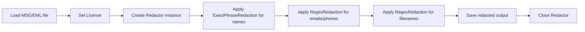

# Redact Outlook MSG and EML Headers & Attachments with GroupDocs Redaction for Java

This repository demonstrates how to redact personal information from Outlook MSG and EML files—including headers and attachments—using GroupDocs Redaction for Java. The solution provides ready-made redaction workflows for email formats, including pattern-based PII detection and batch processing via on-prem SDK.

## Problem
Email files (MSG/EML) often contain sensitive data in headers (e.g., sender, recipient, subject), body text, and attachment metadata. Manual redaction is error-prone and time-consuming, especially at scale. Developers need a reliable, programmatic way to sanitize email content for compliance (e.g., GDPR, HIPAA) or legal discovery.

## What This Example Shows
This showcase demonstrates how to:
- Load MSG/EML files from a local directory
- Apply exact-phrase and regex-based redactions to headers, body, and metadata
- Redact common PII patterns (names, emails, phone numbers, filenames)
- Save sanitized outputs while preserving original formatting

The example processes all `.msg` and `.eml` files in `src/main/resources/input/` and writes redacted versions to `src/main/resources/output/`.

## How it works



**Important:** GroupDocs Redaction for Java redacts content and metadata exposed in the main document stream. Full attachment-level redaction (e.g., modifying embedded `.pdf` attachments) requires additional processing—this example redacts attachment *metadata* (e.g., filenames) but not embedded file content. For deep attachment inspection, combine with GroupDocs.Viewer or use custom extraction.

## Topics covered
Redact personal information from Outlook MSG and EML files including headers and attachments.

## Prerequisites
- Java 8 or higher
- Maven 3.x
- Real email files (`.msg` or `.eml`) placed in `src/main/resources/input/`

## License
This example uses GroupDocs Redaction for Java. To avoid evaluation mode limitations (e.g., document truncation), apply a valid license:
- Get a free 30-day temporary license: [https://purchase.groupdocs.com/temporary-license](https://purchase.groupdocs.com/temporary-license)
- Full documentation: [https://docs.groupdocs.com/redaction/java/](https://docs.groupdocs.com/redaction/java/)

## Setup & Run

1. Clone this repository.
2. Place sample `.msg` or `.eml` files in `src/main/resources/input/`.
3. (Optional) Add a license file at `src/main/resources/groupdocs.redaction.lic`.
4. Run:
   ```bash
   mvn compile exec:java
   ```

Redacted files appear in `src/main/resources/output/`.

## FAQ

**Q: Does this redact embedded attachments (e.g., PDFs inside an email)?**
A: No—this example redacts content *within* the email document (headers, body, metadata), but not the content of embedded attachments. For full attachment redaction, extract attachments first using GroupDocs.Viewer, redact them separately, then re-embed.

**Q: Can I redact only specific headers (e.g., "Subject" but not "From")?**
A: GroupDocs Redaction for Java operates on the entire document text. To target specific headers, use regex with context (e.g., `Subject:.*`) or preprocess the email to isolate header sections.

**Q: Why is my redacted email still showing PII?**
A: Ensure your input files are in MSG/EML format (not HTML/RTF exports). Also, verify the PII matches the exact phrases or regex patterns used in the code (case sensitivity, spacing, etc.).

See `src/main/java/com/groupdocs/redaction/examples/RedactOutlookEmailHeadersExample.java` — the `run()` method is written as **Steps 1–8** with comments.